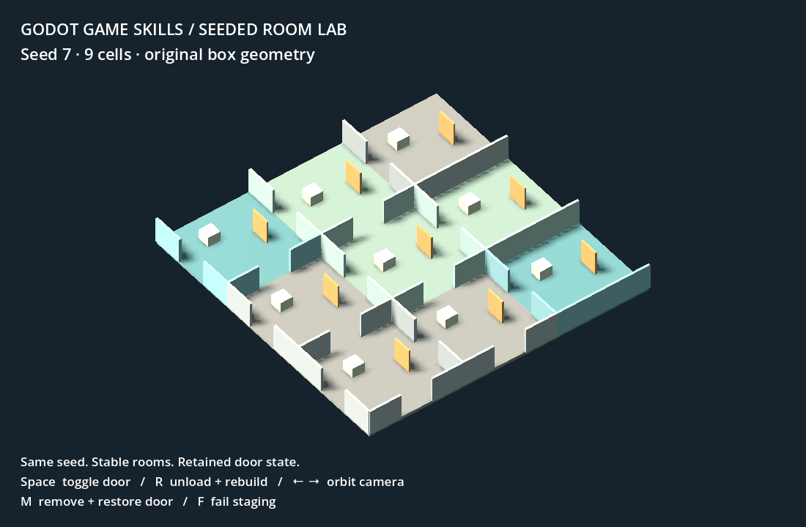

# Godot Game Skills

**Practical agent skills for building, debugging, and verifying Godot games.**

Eight focused skills turn production lessons from a procedural 3D game into
reusable workflows: stable generation, retained object state, measured
performance, reliable checks, authored props, horror pacing, analog presentation
and believable wear. Each skill can be installed on its own.

The package includes working tools and a small original Godot project. It needs
no paid API, asset service, MCP server or particular model. The most direct fit
is Godot 4 with GDScript and 3D scenes. It is an agent-skills pack, not an editor
plugin or a complete game framework.

**Start here:** [User handbook](docs/USER_HANDBOOK.md) for setup, skill selection,
step-by-step workflows, tool usage and troubleshooting. Use the
[prompt cookbook](docs/PROMPT_COOKBOOK.md) for ready-to-adapt requests covering
all eight skills and combined workflows.

## The game behind these skills

[](https://youtu.be/plEL_W2lK_w)

**[Watch the It Wants You To Stay demo reel on YouTube](https://youtu.be/plEL_W2lK_w)**

These skills grew out of developing **It Wants You To Stay**, a Godot horror game.
As I built the game, I refined workflows for procedural environments, persistent
world state, debugging, performance, horror pacing and visual presentation. I
extracted those lessons into the eight skills, supporting tools and original
examples in this repository so other Godot developers can apply them to their
own projects.

## Install

Clone the repository and open its directory:

```sh
git clone https://github.com/TheMarco/godot-game-skills.git
cd godot-game-skills
```

Then run from its root with Python 3.10+:

```sh
# Inspect changes without installing anything.
python3 scripts/install.py --agent codex --dry-run

# Install all eight skills for one agent.
python3 scripts/install.py --agent codex
python3 scripts/install.py --agent claude

# Or install one skill into an explicit skills directory.
python3 scripts/install.py --dest /path/to/agent/skills --skill godot-procedural-worlds
```

Codex installation uses `$CODEX_HOME/skills` when configured, otherwise
`~/.codex/skills`. Claude installation uses `~/.claude/skills`. Use `--dest` for
other skill-compatible hosts or project-local installation. Avoid installing
duplicate copies into multiple directories discovered by the same agent.

Existing same-named skills are skipped. `--force` moves each replaced skill to
`.godot-game-skills-backups/` inside the destination first; unrelated skills are never
removed. To uninstall, remove only the skill folders you installed. The
installer does not alter agent settings or register background processes.

## Use

Open your game project with the agent and request the outcome you want:

> Use godot-dev-director to add a procedural warehouse wing. Preserve the
> existing lighting and saved door states. Verify one representative room
> before extending the other variants.

For a specific problem, name the specialist directly. In hosts supporting dollar
invocation, use `$godot-procedural-worlds`, for example. Skills provide workflows;
the host supplies file access, terminal execution and any visual inspection tools.

| Skill | Good first request |
| --- | --- |
| [Development director](skills/godot-dev-director/SKILL.md) | Coordinate a change spanning several game systems. |
| [Game verification](skills/godot-game-verification/SKILL.md) | Reproduce a bug and add a focused check that cannot pass silently. |
| [Procedural worlds](skills/godot-procedural-worlds/SKILL.md) | Fix shared walls or doors resetting after rooms unload. |
| [Performance workflows](skills/godot-performance-workflows/SKILL.md) | Diagnose room-entry hitches while preserving the current look. |
| [3D prop integration](skills/godot-3d-prop-integration/SKILL.md) | Replace a primitive with a GLB and keep its collision and behavior. |
| [Horror pacing](skills/godot-horror-pacing/SKILL.md) | Stop ambient events interrupting encounters and story moments. |
| [Analog presentation](skills/godot-analog-presentation/SKILL.md) | Separate camera interference, CRT display and comfort settings. |
| [Environment wear](skills/godot-environment-wear/SKILL.md) | Add stable, cause-based wear that follows its supporting objects. |

The director is optional. Specialists do not require one another or this README
after installation. They preserve project-specific art direction, gameplay rules
and existing test frameworks.

## Try the example

[Seeded Room Lab](skills/godot-procedural-worlds/assets/seeded-room-lab/README.md)
is a nine-cell scene using original box geometry. It demonstrates canonical
shared edges, build-order-independent generation, mutable door state surviving
rebuilds, and safe rejection of a failed staging attempt.



Install an official Godot 4 editor binary and make `godot` available on PATH, or
pass its executable path with `--godot` to the runner. From this repository:

```sh
godot --path skills/godot-procedural-worlds/assets/seeded-room-lab

python3 skills/godot-game-verification/scripts/run_checks.py \
  --project skills/godot-procedural-worlds/assets/seeded-room-lab \
  --manifest skills/godot-procedural-worlds/assets/seeded-room-lab/checks.json
```

`Space` toggles the center door. `R` unloads and rebuilds rooms. `M` removes or
restores the door while retaining its state. `F` rejects a staged replacement.
Arrow keys orbit the camera. This is a contract demonstration, not a player
controller, complete streaming engine or guarantee of navigable generated maps.

## Tools you can use without an agent

- **[Check runner](skills/godot-game-verification/references/checks.md):** JSON
  manifests, one import pass, bounded processes, explicit success markers,
  error scanning and separate run reports. A zero exit code alone is insufficient.
- **[Timing comparison](skills/godot-performance-workflows/references/measurement.md):**
  compare matched raw samples; report mean, median, p95 and maximum separately.
  Reject incompatible contexts and retain the distinction between subsystem time
  and whole-game performance.
- **[Example checks](skills/godot-procedural-worlds/assets/seeded-room-lab/checks):**
  deterministic construction, canonical boundaries, state round trips and
  rejected scene replacements.

## Compatibility and evidence

Python helpers use the standard library and require Python 3.10+. Godot examples
use Godot 4 GDScript and the Compatibility renderer. Tested environments and
remaining gaps are recorded in [validation notes](docs/VALIDATION.md).
Headless checks do not prove visual quality, renderer compatibility or gameplay
feel. Run the relevant rendered/motion check in the consumer's actual game.

To check package changes:

```sh
python3 scripts/validate_package.py
python3 -m unittest discover -s tests -v
```

The CI workflow runs Python validation and helper tests. Godot integration and
rendered checks are explicit local steps until additional environments are
verified. See [contributing](CONTRIBUTING.md) for realistic skill evaluations.

## Origins and license

Extracted from developing **It Wants You To Stay**, with original minimal
examples and portable helpers. The [Three.js Game Skills project](https://github.com/majidmanzarpour/threejs-game-skills)
inspired the package format. Its code and game assets are not bundled.
See [extraction notes](docs/EXTRACTION.md) for what was generalized.

MIT licensed; see [LICENSE](LICENSE). No Liminal story, recordings, commercial
models, textures, music, credentials or generated import caches are included.
